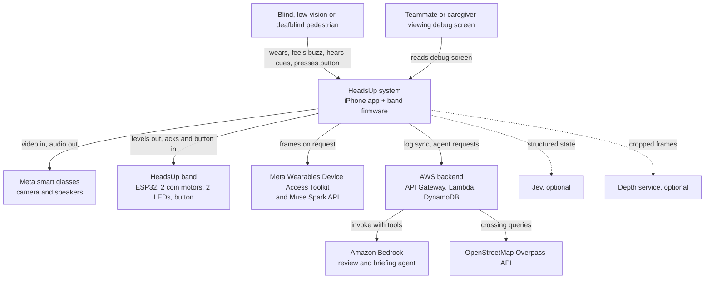
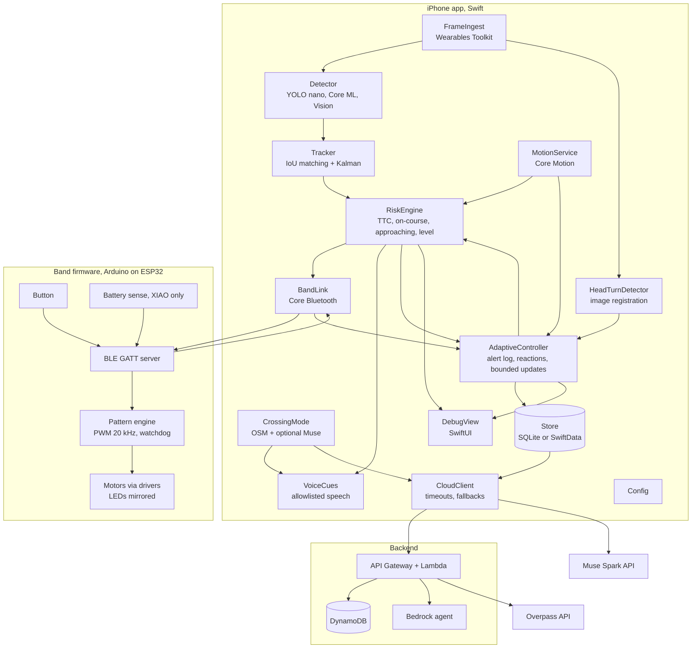
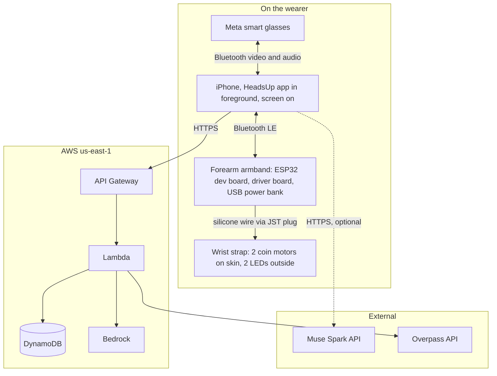

# HeadsUp Design and Implementation Specification

Version 2, November 14, 2026. HeadsUp team, HackPrinceton 2026 (healthcare and accessibility track, Amazon AI track).

This document is the single source of truth for building HeadsUp. It is written for the people and coding agents implementing it. Every number, format and rule in it is a decision, not a suggestion, unless it is marked "tunable" or "optional". If something you need is not specified here, follow section 0.3.

# 0. HOW TO USE THIS DOCUMENT

## 0.1 Reading order

1. Section 0 (rules for implementers).
2. BUSINESS POSTURE and SECURITY POSTURE (what we are building and what must never break).
3. DESIGN, especially C4 CONTAINER (the modules you will write).
4. IMPLEMENTATION SPECIFICATION (section 9 onward): exact interfaces, algorithms, constants and formats.
5. BUILD PLAN (section 18): the order to build in and the test that must pass before moving on.

## 0.2 Rules for implementers

1. Build in the order of section 18. Do not start a milestone until the previous one passes its "done when" test.
2. The safety invariants in section 4 are never weakened, skipped or "temporarily disabled", even for a demo. If a task seems to require breaking one, stop and ask a human.
3. All tunable numbers live in one place: `Config.swift` on the phone and `config.h` on the band. Never hardcode a constant from section 10 anywhere else.
4. The warning path (camera frame to wrist buzz) must never wait on the network, the cloud, an LLM, or any optional component. If you find yourself adding an `await` on a network call inside the warning path, that is a bug.
5. Optional components (marked "optional") are built only after milestone M6 passes. Each must be switchable off with one config flag, and the system must behave identically to the core when it is off.
6. Prefer the simplest implementation that passes the acceptance test. This is a 36-hour prototype.
7. Do not add features, outputs or phrases that are not in this document. In particular, never add any spoken or haptic output that tells the user to move, or that says anything is safe or clear (section 4).

## 0.3 When this document is silent or ambiguous

1. Safety invariants (section 4) win over everything.
2. Then this document.
3. Then the simplest choice that passes the tests.
4. Record every such choice in `docs/DECISIONS.md` as one line: date, what was unclear, what you chose, why. A human reviews this file.

## 0.4 Glossary

| Term | Meaning |
| --- | --- |
| TTC | Time-to-collision in seconds: how long until an object reaches the wearer if it keeps moving as it is |
| Track | One detected object followed across frames, with a stable integer id |
| Level | Alert urgency sent to the band: 0 quiet, 1 slow pulses, 2 fast pulses, 3 continuous |
| Side | Which half of the camera view the hazard is in: left or right (camera-relative, so it follows the head) |
| Lead time (T) | The learned TTC at which the urgent level 3 fires. Floor 1.5 s, ceiling 4.0 s |
| Context | One of four buckets that keep separate learned settings: walking-busy, walking-quiet, standing-busy, standing-quiet |
| Movable class | One of the object classes allowed to trigger alerts (section 11.1) |
| Reflex path | Everything from frame arrival to band write. On-device, offline, no waiting on anything optional |

# 1. BUSINESS POSTURE

HeadsUp is an awareness aid for blind and low-vision pedestrians. Meta smart glasses stream video to an iPhone app. The app detects people, bikes and vehicles that are on a course toward the wearer and actually moving toward them, and a wrist-worn band buzzes on the side of the hazard, with urgency encoded as rhythm. LEDs on the band mirror the motors so the alert is visible on camera and to people nearby. Short spoken cues play through the glasses' speakers. The system works alongside the white cane, not instead of it. Because alerts are haptic first, the system also serves deafblind users, for whom the spoken cues do not help.

Pitch line: "HeadsUp tells you what's around you. You decide what to do."

## 1.1 Goals, in priority order

1. A working end-to-end loop at judging: glasses camera to phone to wrist buzz, with the measured camera-to-buzz delay on screen.
2. Selectivity: the system stays quiet for a passerby, a person crossing in front, a standing person and a pole, and warns on an approaching person, bike or vehicle.
3. Adaptation: alert lead time tunes itself to the wearer's measured reaction time, within fixed safety bounds, visible on the debug screen.
4. An agentic layer for the Amazon track: a Bedrock agent that reviews walk logs, explains patterns, proposes bounded setting changes, and briefs the user on crossings before a trip.
5. Honesty: the product reports what is around the user. It never tells them where to walk or that a crossing is safe.

## 1.2 Judging criteria (Amazon track)

Creativity, usefulness, technical implementation and user experience each count 25 percent. Required submission: working prototype or demo, clear use case and target user, basic documentation, and a pitch.

## 1.3 Risk appetite

Four-person student team, 36-hour deadline. High appetite for fast iteration. Zero appetite for physical harm to any demo participant. Zero appetite for misleading safety claims.

## 1.4 Most important business risks

1. Meta's Wearables Device Access Toolkit does not deliver live frames on the exact glasses and phone in hand. Everything depends on this, so it is milestone M1.
2. False alarms make the band annoying. Mitigation: class filter, on-course check, moving-versus-static check, confidence gate.
3. A missed or late warning in the demo. Mitigation: conservative defaults, lead-time floor, measured accuracy shown on screen.
4. An unsupported claim (all directions, replaces the cane, safe to cross). Mitigation: coverage limits stated up front in the pitch and the app.
5. Hackathon Wi-Fi. Mitigation: the reflex path is fully on-device.
6. Injury during filming. Mitigation: section 19 demo protocol.

## 1.5 Non-goals (do not build)

- Turn-by-turn navigation or any instruction to move.
- Any "safe to cross", "clear", or "go" output.
- Rear or side sensing hardware (radar, extra cameras). Mention as future work only.
- Long-term object memory pitched as surround coverage. Short track persistence (section 11.3) is allowed.
- A general chat assistant.
- Any cloud dependency in the reflex path.

# 2. SECURITY POSTURE

## 2.1 Existing security controls

- security control: The reflex path runs entirely on the phone with no network dependency. Loss of connectivity or a failing cloud service cannot stop warnings.
- security control: The band stops all motors and LEDs if no valid command arrives for 600 ms.
- security control: Adaptive timing is bounded: lead time stays within 1.5 s to 4.0 s. Earlier changes apply immediately; later changes apply slowly and within bounds.
- security control: AI agent output is a proposal only. The phone clamps every proposal to the bounds, and any change that makes alerts later or margins tighter needs explicit user confirmation.
- security control: Spoken output is restricted to an allowlist of phrase templates (section 14.2). Every other string is rejected in code.
- security control: Demo protocol forbids anyone standing in the path of a moving vehicle.

## 2.2 Accepted risks (hackathon only)

- accepted risk: The phone-to-band Bluetooth link is not authenticated or encrypted at the application layer. Worst case is a nuisance buzz.
- accepted risk: Cloud API keys may live in a thin backend or, if time runs out, in the app for the demo only. Keys are rotated after the event.
- accepted risk: Frames sent to optional cloud services are not face-redacted.
- accepted risk: The alert log is stored unencrypted on the phone.
- accepted risk: No formal secure development lifecycle.

## 2.3 Recommended controls (build if time allows, in this order)

1. Command sequence numbers with stale-command rejection on the band (already in the packet format, section 13; enforce it).
2. API keys only in the backend, never in the app binary or the repository. Add `.gitignore` entries and run a secrets scan before the final push.
3. Timeouts on every cloud call (section 10) with late answers discarded.
4. Audit log of every setting change (who, what, before, after, reason, confirmed). Already required by section 12.6.
5. A local "reset learning" switch that restores defaults and disables adaptation.
6. Band pinned to one phone: the first connecting phone writes a 4-byte pairing token; the band then ignores writes without it. Optional.
7. Send only cropped object regions to any cloud vision service.

## 2.4 Security requirements

- Authentication: cloud calls are authenticated by a key held in the backend.
- Authorization: only the user can approve changes that make alerts later. The agent can propose, never apply.
- Input validation: the band validates packet length, version, level range and sequence number (section 13). The app validates every agent proposal against the allowed keys and ranges (section 15.4).
- Cryptography: all cloud traffic uses HTTPS.
- Availability: the reflex path works with no network and with every optional component off.
- Privacy: no video frames are stored. Logs contain classes, timings and settings, not images. Location is stored only for remembered spots, rounded to about 10 m.

# 3. DESIGN

The system has three physical parts (glasses, phone, band) and two cloud roles (scene understanding, agent). The phone is the hub. The glasses and the band never talk to each other.

## 3.1 Processing layers

| Layer | Runs on | Job | Latency budget | Required |
| --- | --- | --- | --- | --- |
| Reflex | iPhone | Detect, track, Kalman, TTC, on-course, moving-vs-static, level, band write | Under 50 ms after frame arrival | Yes |
| Controller | iPhone | Alert log, reaction detection, bounded learning | Per alert, immediate | Yes |
| Understanding | Muse Spark (Meta Model API) | Crosswalk recognition, "what's around me", signs | About 1 s or more, timeout 4 s | Optional |
| Agent | Amazon Bedrock via backend | Post-walk review, bounded proposals, trip briefing | Seconds, user-initiated | Yes, after M6 |
| Quick decisions | Jev | Crossing trigger probability, announcement choice | Timeout 300 ms | Optional, default off |
| Depth refinement | Laptop or AWS GPU | Better distance per track a few times per second | Never blocks reflex | Optional, default off |

## 3.2 C4 CONTEXT



| Name | Type | Description | Responsibilities | Security controls |
| --- | --- | --- | --- | --- |
| Pedestrian | Person | Primary user, walking with a cane, band on the non-cane wrist | Responds to cues, presses "that was nothing", confirms proposals | Sole authority for changes that make alerts later |
| Teammate or caregiver | Person | Secondary viewer | Reads debug screen, runs tests, films demo | None |
| HeadsUp system | Software system | iPhone app plus band firmware | Everything in section 3.1 | Offline reflex path, bounded learning, phrase allowlist |
| Meta smart glasses | External device | Camera streams to the phone over Bluetooth, about 15 fps, low resolution; speakers are Bluetooth audio | Forward video, play cues | Not under team control |
| HeadsUp band | Team-built device | See section 13 | Render rhythms, mirror on LEDs, watchdog, acks, button | Packet validation, 600 ms watchdog |
| Meta Toolkit and Muse Spark | External system | Camera access SDK and Meta's multimodal model API | Frames; scene understanding on request | HTTPS; frames only on request |
| AWS backend | External system | API Gateway, Lambda, DynamoDB | Hold keys, store logs, run agent tools | IAM least privilege, HTTPS |
| Amazon Bedrock | External system | LLM with tool calling | Review and briefing | Proposals clamped on phone |
| Overpass API | External system | OpenStreetMap queries | Crossing data | Public read-only |
| Jev | External system, optional | Decision model, JSON in, typed answers out | Crossing probability, announcement choice | 300 ms timeout |
| Depth service | External system, optional | Monocular depth model | Better per-track distance | Never in reflex path |

## 3.3 C4 CONTAINER



| Name | Type | Responsibilities | Spec section |
| --- | --- | --- | --- |
| FrameIngest | iOS module | Receive frames, timestamp on arrival, report connection state and measured fps | 11.0 |
| Detector | iOS module | Run YOLO nano, keep only movable classes | 11.1 |
| Tracker | iOS module | IoU matching, stable ids, per-track Kalman filters, persistence through short misses | 11.2, 11.3 |
| RiskEngine | iOS module | TTC, confidence, on-course, distance, speeds, approaching, braking, level, side | 11.4 to 11.10 |
| MotionService | iOS module | Step detection, user speed, walking or standing, stop detection | 12.2 |
| HeadTurnDetector | iOS module | Measure global image shift between frames | 12.3 |
| AdaptiveController | iOS module | Log alerts, detect reactions, label outcomes, update settings within bounds | 12 |
| BandLink | iOS module | Connect, write packets at 5 Hz and on change, parse status, measure delay | 13.3 |
| VoiceCues | iOS module | Speak allowlisted phrases with rate limits | 14 |
| CrossingMode | iOS module | Detect upcoming crossing, run the head-scan script | 16 |
| DebugView | iOS view | Live and learned values, delay, controls | 17 |
| Store | iOS storage | Alert log, settings per context, audit log, calibration | 12.7 |
| CloudClient | iOS module | Backend and Muse calls with timeouts; never called from the reflex path | 15 |
| Config | iOS file | Every constant in section 10 | 10 |
| Band firmware | Arduino sketch | GATT server, pattern engine, watchdog, LEDs, button, battery | 13 |
| Backend | Lambda + DynamoDB | Log sync, agent invocation, tools, OSM proxy | 15 |

## 3.4 C4 DEPLOYMENT



| Name | Type | Description | Notes |
| --- | --- | --- | --- |
| Meta glasses | Wearable | Paired to the iPhone | Camera and open-ear speakers |
| iPhone | Mobile | App runs in the foreground with the screen on during the demo; enable the Bluetooth background mode in Xcode as a fallback | Hosts everything in the reflex path |
| Wrist strap | Wearable | Design C from the 3D model: slim Velcro strap, left motor on the outer wrist, right motor on the inner wrist, LEDs on the outside | Joined to the armband by a JST plug so it unplugs instead of pulling on solder |
| Forearm armband | Wearable | ESP32 dev board, Darlington driver board, USB power from a power bank | Current build. The XIAO plus LiPo variant (section 13.6) is the later target |
| Backend | AWS | us-east-1. A Local Zone saves about 10 ms and is not needed | Holds keys |

# 4. SAFETY INVARIANTS

These are enforced in code and covered by unit tests (section 20.1). No feature, flag or demo mode may bypass them.

| Id | Invariant | Where enforced |
| --- | --- | --- |
| S1 | Lead time T is always within [1.5, 4.0] seconds for every context | AdaptiveController.apply, RiskEngine final clamp |
| S2 | The band turns all motors and LEDs off if no valid command arrives for 600 ms | Firmware watchdog |
| S3 | The app never speaks a string that is not produced by an allowlisted template (section 14.2). Any string containing "safe", "clear", "go ", "move", "walk", "cross now", "step" is rejected even if it slipped into a template | VoiceCues.validate |
| S4 | The reflex path never awaits a network call, LLM, or optional component | Code review rule; test with airplane mode (section 20.3) |
| S5 | Agent proposals are never applied directly. They pass through SettingsValidator, and any change that makes alerts later or margins tighter requires user confirmation | SettingsValidator, ProposalView |
| S6 | Course margin multiplier per class is always within [0.6, 1.0] | AdaptiveController.apply |
| S7 | When confidence is low, level is capped at 2 (never escalates to 3 on a low-confidence track alone) | RiskEngine.level |
| S8 | If the band disconnects, the phone vibrates itself for level 3 alerts as a fallback and shows a red banner | BandLink, DebugView |

# 9. IMPLEMENTATION OVERVIEW

## 9.1 Repository layout

```
headsup/
  docs/
    DESIGN.md            this document
    DECISIONS.md         one line per judgment call (section 0.3)
    TEST_RESULTS.md      measured numbers from section 20
  ios/HeadsUp/
    App/                 app entry, dependency wiring
    Config/Config.swift  every constant in section 10
    Ingest/FrameIngest.swift
    Perception/Detector.swift, Tracker.swift, Kalman.swift
    Risk/RiskEngine.swift, Geometry.swift
    Motion/MotionService.swift, HeadTurnDetector.swift
    Adaptation/AdaptiveController.swift, SettingsValidator.swift
    Band/BandLink.swift, BandProtocol.swift
    Voice/VoiceCues.swift, PhraseTemplates.swift
    Crossing/CrossingMode.swift
    Cloud/CloudClient.swift, AgentModels.swift
    Store/Store.swift, Models.swift
    UI/DebugView.swift, ProposalView.swift, SettingsView.swift, CalibrationView.swift
    Tests/               unit tests for sections 11, 12, 13.2, 14 and all invariants
  firmware/headsup_band/
    headsup_band.ino
    config.h             pins, timings, UUIDs
  backend/
    template.yaml        SAM or CDK, whichever the team knows
    handlers/            log_sync, agent_review, agent_brief, osm_crossings
    agent/               tool schemas (section 15.3) and system prompt (section 15.5)
```

## 9.2 Technology choices (fixed)

| Concern | Choice |
| --- | --- |
| Phone language and UI | Swift, SwiftUI |
| Glasses video | Meta Wearables Device Access Toolkit, starting from Meta's CameraAccess sample |
| Detection | YOLO nano (YOLO11n or YOLOv8n) exported to Core ML with Ultralytics, run through Vision `VNCoreMLRequest`, input 320 or 416 px |
| Tracking | Hand-written IoU tracker plus Kalman filters (sections 11.2, 11.3) |
| Motion | Core Motion: `CMMotionManager` raw accelerometer at 50 Hz, `CMPedometer` for cadence as a cross-check |
| Head turn | Vision `VNTranslationalImageRegistrationRequest` between consecutive downscaled frames |
| Band link | Core Bluetooth, central role |
| Speech | `AVSpeechSynthesizer`, routed to the glasses as the active Bluetooth audio output |
| Storage | SQLite (GRDB) or SwiftData, team's choice; schema in section 12.7 |
| Firmware | Arduino, Espressif ESP32 core 3.x, built-in BLE library |
| Backend | API Gateway, Lambda (Python or Node), DynamoDB, Bedrock (a model with tool calling) |
| Maps | OpenStreetMap Overpass API, called from the backend |

# 10. CONFIGURATION CONSTANTS

All of these live in `Config.swift` (phone) or `config.h` (band). "Tunable" means adjust from test results in section 20; record changes in DECISIONS.md.

| Name | Default | Unit | Tunable | Used in |
| --- | --- | --- | --- | --- |
| movableClasses | person, bicycle, car, motorcycle, bus, truck, dog | | No | 11.1 |
| detectionConfidenceMin | 0.35 | | Yes | 11.1 |
| iouMatchMin | 0.3 | | Yes | 11.2 |
| trackMaxMissedFrames | 8 | frames | Yes | 11.3 |
| trackMinHitsBeforeAlert | 3 | frames | Yes | 11.3 |
| ttcWindow | 0.5 | s | Yes | 11.5 |
| kalmanMeasNoiseL | 0.03 | log-units | Yes | 11.3 |
| kalmanProcNoiseL | 0.5 | per s squared | Yes | 11.3 |
| kalmanMeasNoiseX | 0.01 | normalized | Yes | 11.3 |
| kalmanProcNoiseX | 0.3 | per s squared | Yes | 11.3 |
| ttcMinRate | 0.05 | per s | No | 11.4 |
| confidenceDisagreeMax | 0.5 | ratio | Yes | 11.5 |
| courseMarginDefault | 1.0 | box widths | Yes | 11.6 |
| courseMarginMin | 0.6 | box widths | No (S6) | 12.5 |
| cameraHFOV | measured, see 11.0 | degrees | Measured | 11.6 |
| personHeight | 1.7 | m | No | 11.7 |
| carWidth | 1.8 | m | No | 11.7 |
| approachSpeedMin | 0.7 | m/s | Yes | 11.9 |
| approachConsecutiveFrames | 4 | frames | Yes | 11.9 |
| standingNoStepTime | 1.5 | s | Yes | 12.2 |
| tauDotAccelerating | -1.2 | | Yes | 11.10 |
| tauDotBraking | -0.5 | | No | 11.10 |
| leadTimeDefault | 1.5 | s | No | 11.11 |
| leadTimeFloor | 1.5 | s | No (S1) | 12.5 |
| leadTimeCeiling | 4.0 | s | No (S1) | 12.5 |
| level2Offset | 0.5 | s | Yes | 11.11 |
| level1Offset | 2.5 | s | Yes | 11.11 |
| aheadZone | 0.15 | normalized x | Yes | 14.1 |
| bandWriteInterval | 0.2 | s | No | 13.3 |
| bandWatchdog | 600 | ms | No (S2) | 13.4 |
| reactionWindow | 3.0 | s | Yes | 12.3 |
| stopNoStepTime | 0.8 | s | Yes | 12.2 |
| headTurnShiftMin | 0.08 | frame widths | Yes | 12.3 |
| safetyMargin | 0.8 | s | Yes | 12.5 |
| nearMissTTC | 1.0 | s | Yes | 12.4 |
| busyObjectCount | 3 | tracks in last 5 s | Yes | 12.1 |
| voiceMinInterval | 2.0 | s | Yes | 14.1 |
| cloudTimeoutMuse | 4.0 | s | Yes | 15 |
| cloudTimeoutAgent | 20.0 | s | Yes | 15 |
| cloudTimeoutJev | 0.3 | s | Yes | 15 |
| crossingTriggerDistance | 25 | m | Yes | 16 |
| pwmFrequency | 20000 | Hz | No | 13.4 |
| motorStrength | 255 | 0 to 255 | Yes | 13.4 |
| kickMs | 30 | ms | Yes | 13.4 |

# 11. REFLEX PATH SPECIFICATION

All image coordinates are normalized: x and y in [-0.5, 0.5] relative to the image center, widths and heights as fractions of image width. Time t is the frame arrival timestamp in seconds (monotonic clock), never the processing time.

## 11.0 Frame ingest and camera calibration

- FrameIngest delivers `Frame { image: CVPixelBuffer, t: TimeInterval, index: Int }` on a serial queue. If the detector is busy when a new frame arrives, drop the older pending frame (always process the newest).
- It exposes `fps` (rolling 2 s average) and `isConnected`.
- Focal length in normalized units: `f = 0.5 / tan(cameraHFOV / 2)` where cameraHFOV is in radians. Then a normalized x maps to the angle `atan(x / f)`.
- Measuring cameraHFOV (do once, in CalibrationView): place a flat object of known width W (meters) at a measured distance D (meters) straight ahead, read its box width w (normalized) from the debug screen, then `f = w × D / W` and store f directly. Repeat three times and average.

## 11.1 Detector

- Input: newest Frame. Output: `[Detection { cls: ObjectClass, conf: Float, box: Box(cx, cy, w, h) }]` in normalized coordinates.
- COCO class ids to keep: 0 person, 1 bicycle, 2 car, 3 motorcycle, 5 bus, 7 truck, 16 dog. Drop everything else and anything with conf below detectionConfidenceMin.
- Run in under 30 ms per frame on the team's iPhone. Measure and show it on the debug screen.

## 11.2 Tracker matching

- Each frame: predict every track forward (11.3), compute IoU between each predicted box and each detection of the same class, greedily match highest IoU first while IoU is at least iouMatchMin.
- Unmatched detection: new track with a new integer id.
- Unmatched track: increment `missed`. Delete it when missed exceeds trackMaxMissedFrames.
- A track is "eligible" to alert only after trackMinHitsBeforeAlert matched frames.

## 11.3 Kalman filters (per track)

Two independent 2-state constant-velocity filters per track:

1. Size filter, state `[L, Ldot]`, where `L = ln(sqrt(w × h))`.
2. Position filter, state `[x, xdot]`, where x is the box center cx.

For each, with dt = time since that track's last update:

```
F = [[1, dt], [0, 1]]
H = [1, 0]
Q = q × [[dt^4/4, dt^3/2], [dt^3/2, dt^2]]      q = kalmanProcNoiseL or kalmanProcNoiseX
R = r^2                                          r = kalmanMeasNoiseL or kalmanMeasNoiseX
predict:  s = F s,  P = F P F^T + Q
update:   y = z - H s,  S = H P H^T + R,  K = P H^T / S,  s = s + K y,  P = (I - K H) P
```

Initialize `[z, 0]` with `P = diag(r^2, 1.0)`. On a missed frame run predict only. Tune r by pointing the camera at a standing teammate for 10 s and setting r to the standard deviation of the measured L (and of x). Tune q until a real approach shows up within about 0.3 s without flicker.

## 11.4 Time-to-collision

```
TTC = 1 / Ldot        if Ldot > ttcMinRate
TTC = infinity        otherwise (not approaching)
```

Use the Kalman Ldot, not a two-frame difference.

## 11.5 Confidence

Over the last ttcWindow seconds of matched measurements, fit straight lines to ln(w) versus t and to ln(h) versus t (ordinary least squares). Slopes give `TTCw = 1 / slope_w` and `TTCh = 1 / slope_h` (infinity if slope at or below ttcMinRate).

```
lowConfidence = (fewer than 4 measurements in the window)
             or (both finite and abs(TTCw - TTCh) / min(TTCw, TTCh) > confidenceDisagreeMax)
             or (box touches the image edge, any side within 0.01)
```

## 11.6 On-course check

```
M = TTC × xdot                         predicted sideways position at arrival, normalized units
onCourse = abs(M) < courseMargin[cls] × w     w = current box width, normalized
```

courseMargin per class starts at courseMarginDefault and is learned within [0.6, 1.0] (section 12.5). If TTC is infinite, onCourse is false.

## 11.7 Distance (known size)

```
Z = f × personHeight / h      for person (and dog: use 0.6 m height)
Z = f × carWidth / w          for car, bus, truck
Z = f × 1.1 / h               for bicycle and motorcycle (rider plus bike height about 1.7 m: use 1.7 if a rider is detected overlapping, else 1.1)
```

Expect about 30 percent error. Distance is used only in 11.8 and 11.9, never to compute TTC.

## 11.8 Speeds

```
vUser  = MotionService.currentSpeed       m/s, 0 when standing (12.2)
vClose = Z / TTC                          m/s, 0 if TTC infinite
vObj   = vClose - vUser
```

## 11.9 Approaching (moving toward the wearer)

```
if MotionService.isStanding:
    approachingNow = TTC < leadTime + level1Offset          everything that grows is moving
else:
    approachingNow = vObj > approachSpeedMin
approaching = approachingNow held for approachConsecutiveFrames consecutive frames
```

## 11.10 Braking or speeding up (tau-dot)

Keep the last 1 s of finite TTC values with timestamps; tauDot is the least-squares slope of TTC versus t.

```
tauDot < tauDotAccelerating  -> raise level by 1 (max 3)
tauDot > tauDotBraking       -> lower level by 1 (min 0)
otherwise                    -> no change
```

Only apply when at least 6 finite TTC samples exist in that second.

## 11.11 Level and side

Let T be the lead time for the current context (section 12.1), already clamped to [1.5, 4.0].

```
eligible = track has trackMinHitsBeforeAlert hits and cls in movableClasses
raw = 0
if eligible and onCourse and approaching:
    if TTC < T:                    raw = 3
    elif TTC < T + level2Offset:   raw = 2
    elif TTC < T + level1Offset:   raw = 1
apply tau-dot adjustment (11.10)
if lowConfidence: raw = min(raw, 2)                        S7
side = left if x < 0 else right
```

With the default T of 1.5 s this gives level 3 under 1.5 s, level 2 under 2.0 s, level 1 under 4.0 s.

Band output per frame: `leftLevel = max level over tracks with side left`, `rightLevel = max over side right`. Then apply the "which wrist" setting: if the band is worn on the right wrist, swap the two values before sending (the motor on the outer wrist always means "left of the camera view" for a left-wrist wearer, and the physical channels swap on the right wrist).

The RiskEngine also publishes, per track: id, cls, box, TTC, confidence, onCourse, M, Z, vObj, approaching, tauDot, level. The debug screen shows these.

# 12. ADAPTIVE CONTROLLER SPECIFICATION

Plain Swift. No LLM. Runs on the phone.

## 12.1 Context

```
movement = standing if MotionService.isStanding else walking
density  = busy if distinct eligible tracks in the last 5 s >= busyObjectCount else quiet
context  = movement + "-" + density        one of 4 values
```

Each context has its own `leadTime` and its own `reactionEstimate`. courseMargin is per class, shared across contexts.

## 12.2 MotionService

- Accelerometer at 50 Hz. Compute magnitude of userAcceleration plus gravity, band-pass 0.5 to 3 Hz (or subtract a 1 s moving average), detect peaks above 0.15 g with at least 0.3 s between peaks. Each peak is a step.
- cadence = steps per second over the last 3 s. currentSpeed = cadence times stepLength.
- stepLength comes from CalibrationView: walk a taped 20 m, stepLength = 20 / steps, average 2 to 3 runs. Default before calibration: 0.41 times the user's entered height, or 0.65 m.
- isStanding = no step for standingNoStepTime.
- stoppedAt(after:) = the time of the last step before a gap of at least stopNoStepTime that starts after the given time, or nil.

## 12.3 Reaction detection

For each alert that reaches level 2 or 3 (the "alert onset" is the first frame at that level for that track):

```
tStop = MotionService.stoppedAt(after: onset)              within reactionWindow
tTurn = first time after onset when the summed horizontal image shift over any 0.5 s span exceeds headTurnShiftMin
reactionTime = min(tStop, tTurn) - onset                   nil if neither happens within reactionWindow
```

HeadTurnDetector: downscale consecutive frames to 160 px wide grayscale, run `VNTranslationalImageRegistrationRequest`, and take the x translation divided by frame width.

## 12.4 Outcome labels

Evaluate when the track ends or reactionWindow passes, whichever is later. First match wins:

| Outcome | Rule | Effect |
| --- | --- | --- |
| falseAlarm | Button press (status type 0x02) within reactionWindow of onset | 12.5 false alarm rule |
| nearMiss | Track's minimum TTC below nearMissTTC and (reactionTime is nil or reactionTime > TTC at onset minus nearMissTTC) | 12.5 near-miss rule |
| good | reactionTime is not nil | 12.5 reaction rule |
| ignored | Anything else | No learning update. Logged only |

## 12.5 Update rules

All updates go through `apply(change, reason)` which clamps, logs to the audit table, and persists.

Reaction rule (good):
```
r = reactionTime
alpha = 0.3 if r > reactionEstimate else 0.1          lean toward slower reactions
reactionEstimate = reactionEstimate + alpha × (r - reactionEstimate)
target = reactionEstimate + safetyMargin
if target > leadTime: leadTime = target                         earlier, immediately
else: leadTime = leadTime - min(0.05, leadTime - target)        later, slowly
leadTime = clamp(leadTime, 1.5, 4.0)                            S1
```
Initial reactionEstimate = 0.7 s.

Near-miss rule: `leadTime = clamp(leadTime + 0.3, 1.5, 4.0)` for the current context.

False alarm rule: `courseMargin[cls] = max(0.6, courseMargin[cls] × 0.95)`.

Recovery: each good outcome for a class moves `courseMargin[cls]` toward 1.0 by 0.02.

Reset: SettingsView has "Reset learning" which restores all defaults and logs the reset.

## 12.6 Audit log

Every change writes: timestamp, key (for example "leadTime.walking-busy"), before, after, reason ("good", "nearMiss", "falseAlarm", "agentProposal", "reset"), source ("controller", "agent", "user"), confirmed (bool). The debug screen shows the last 10.

## 12.7 Store schema

```
alerts(id, t_onset, track_id, cls, side, level_max, ttc_at_onset, ttc_min,
       context, reaction_time NULL, outcome, lat NULL, lon NULL)
settings(key PRIMARY KEY, value, updated_at)
audit(id, t, key, before, after, reason, source, confirmed)
calibration(key PRIMARY KEY, value)        stepLength, focalLength, wearWrist
trials(id, t, kind, predicted_ttc, actual_ttc, notes)
```

lat and lon are stored only when the user enables "remember places", rounded to 4 decimal places.

# 13. BAND SPECIFICATION

## 13.1 GATT layout

| Item | UUID | Properties |
| --- | --- | --- |
| Service | 7a1e0001-4c2b-4f5e-9b0a-2d1c3e4f5a60 | |
| Command characteristic | 7a1e0002-4c2b-4f5e-9b0a-2d1c3e4f5a60 | Write Without Response |
| Status characteristic | 7a1e0003-4c2b-4f5e-9b0a-2d1c3e4f5a60 | Notify |

Advertised name: "HeadsUp-" followed by the last 4 hex digits of the band's MAC address, so several bands at the venue are distinguishable.

## 13.2 Packet formats (little-endian)

Command, phone to band, exactly 6 bytes:

| Byte | Field | Values |
| --- | --- | --- |
| 0 | version | 0x01 |
| 1 to 2 | seq | uint16, increments by 1 per packet, wraps |
| 3 | leftLevel | 0 to 3 |
| 4 | rightLevel | 0 to 3 |
| 5 | flags | bit 0: LEDs enabled (1 = on). bit 1: test mode (play each level for 1 s on both sides). Other bits 0 |

The band rejects (ignores, does not reset the watchdog) any packet with wrong length, wrong version, a level above 3, or a seq that is not newer than the last accepted seq (newer means `(int16)(seq - lastSeq) > 0`).

Status, band to phone:

| Type byte 0 | Meaning | Remaining bytes |
| --- | --- | --- |
| 0x01 | Ack | bytes 1 to 2: seq of the accepted command |
| 0x02 | Button | byte 1: 0x01 single press, 0x02 long press (over 1 s) |
| 0x03 | Battery | bytes 1 to 2: millivolts, uint16. Sent every 30 s. XIAO only |

## 13.3 BandLink (phone)

- Scan for the service UUID, connect to the strongest "HeadsUp-" device, or the one saved in calibration.
- Write a command packet every bandWriteInterval (200 ms) even if nothing changed (heartbeat), and immediately when either level changes.
- Keep `sentAt[seq]`. On Ack, `bleDelay = now - sentAt[seq]`. Publish the rolling median of the last 20.
- End-to-end delay shown on the debug screen = (band ack time minus frame arrival time for the frame that caused the change) plus the measured glasses stream delay if available. Label the parts separately.
- On disconnect: show a red banner, play a phone vibration for every level 3 onset (S8), and reconnect automatically.
- Test button in DebugView sends flags bit 1.

## 13.4 Firmware behavior

- Pattern per level, per side, driven by its own timer so Bluetooth jitter does not affect rhythm:

| Level | Pattern |
| --- | --- |
| 0 | Off |
| 1 | 150 ms on, 350 ms off |
| 2 | 100 ms on, 100 ms off |
| 3 | Continuous |

- Motor output: LEDC PWM at 20 kHz, 8-bit, duty motorStrength. If motorStrength is below 200, each on-period starts with kickMs at duty 255.
- LEDs mirror motor on-state when flags bit 0 is set.
- Watchdog: if no valid command for 600 ms, all outputs off until the next valid command (S2).
- Every accepted command is acknowledged with status 0x01.
- Button: input with internal pull-up, 30 ms debounce, single press and long press events.
- On boot: all outputs off, advertise, one short 100 ms buzz on each side in turn as a self-test.

## 13.5 Wiring, current build (ESP32 dev board, design C)

| Signal | ESP32 dev board pin | Notes |
| --- | --- | --- |
| Left motor driver | GPIO26 through 1 kΩ to the left Darlington base | Emitter to GND. Motor between collector and motor supply. Diode across motor, stripe to + |
| Right motor driver | GPIO27 through 1 kΩ to the right Darlington base | Same as left |
| Motor supply | VIN (5 V on USB) | The Darlington loses about 1 V; from 3V3 the buzz is too weak |
| Left LED | GPIO26 through 330 Ω to the LED, LED to GND | Same pin as the left motor, so it mirrors automatically. Blue LED |
| Right LED | GPIO27 through 330 Ω to the LED, LED to GND | Red or yellow LED |
| Button | GPIO13 to button, button to GND | Internal pull-up |
| Power | USB-C from a power bank | |

Avoid GPIO 0, 2, 5, 12 and 15 (they affect boot), 6 to 11 (flash), and 34 to 39 (input only).

If the LEDs share the motor pins, flags bit 0 cannot turn them off. That is acceptable for the hackathon. If separate control is wanted, use GPIO32 (left LED) and GPIO33 (right LED) and drive them from the pattern engine.

## 13.6 Wiring, XIAO ESP32-C3 variant (later)

| Signal | XIAO pin |
| --- | --- |
| Left motor driver | D2 through 1 kΩ |
| Right motor driver | D3 through 1 kΩ |
| LEDs | Same pins as motors, each through 330 Ω |
| Button | D10 to GND, internal pull-up |
| Battery sense | A1 (D1) from the midpoint of two 100 kΩ resistors between BAT+ and GND; battery mV = reading times 2 |
| Battery | JST pigtail to BAT+ and BAT− pads, through the slide switch on +. The team's EEMB battery has reversed wire colors: wire by multimeter, never by color |

Avoid D0, D8 and D9 (boot strapping pins). With PN2222 drivers, power the motors from 3V3; with Darlingtons, power them from the battery line after the switch.

# 14. VOICE CUES

## 14.1 When to speak

- On a track's transition to level 2 or higher: speak `"{class}, {direction}"` once.
- direction = "ahead" if abs(x) < aheadZone, else "left" or "right" from the camera view.
- At most one phrase per voiceMinInterval overall. If several tracks qualify, speak the one with the lowest TTC.
- Never speak for level 1.

Class words: person, bike (bicycle and motorcycle), car (car, bus, truck), dog.

## 14.2 Allowlist (the only strings the app may speak)

| Template | Example |
| --- | --- |
| "{class}, {direction}" | "bike, left" |
| "Crossing ahead." | |
| "Look left." | |
| "Look right." | |
| "{class} on the {left/right}." | "car on the left." |
| "No {cars/bikes/people} seen on the {left/right}." | "No cars seen on the left." |
| "Band disconnected." | |
| "Band connected." | |
| Agent briefing text, after passing 14.3 | |

## 14.3 Validation

VoiceCues.speak(phrase) checks the phrase against the templates. Agent briefing text is checked against the forbidden list (case-insensitive): "safe", "clear", "go ahead", "go now", " go ", "move", "walk", "cross now", "step", "you can cross". Any match: do not speak it, log it, and show it on the debug screen in red (S3).

# 15. CLOUD AND AGENT SPECIFICATION

Nothing in this section may be called from the reflex path (S4). All calls run on a background queue with the timeouts in section 10, and late answers are dropped.

## 15.1 Backend endpoints

| Method and path | Body | Returns |
| --- | --- | --- |
| POST /logs/sync | `{deviceId, alerts:[...], trials:[...], settings:{...}}` new rows since last sync | `{ok:true}` |
| POST /agent/review | `{deviceId, since}` | `{summary: string, proposals: [Proposal]}` |
| POST /agent/brief | `{deviceId, origin:{lat,lon}, destination:{lat,lon}}` | `{briefing: string, crossings:[Crossing]}` |
| GET /osm/crossings | `?lat=&lon=&radius=` | `[Crossing]` |

`Crossing = {lat, lon, type: "traffic_signals" | "marked" | "unmarked" | "unknown", lanes: int or null, tactilePaving: bool or null}`

DynamoDB tables: `alerts` (partition deviceId, sort t_onset), `trials` (deviceId, t), `settingsSnapshots` (deviceId, t).

## 15.2 Overpass query

Fetch `node["highway"="crossing"]` and `node["crossing"]` within the radius. Map the `crossing` tag to type. Read `lanes` from the nearest way tagged `highway` that the node belongs to, when available. Cache per 100 m grid cell for 24 hours.

## 15.3 Agent tools (Bedrock tool definitions)

```
read_alert_log      input {since: ISO8601}           output [{t, cls, side, level_max, ttc_at_onset, ttc_min, context, reaction_time, outcome}]
get_settings        input {}                         output {leadTime:{context: seconds}, courseMargin:{class: multiplier}, reactionEstimate:{context: seconds}}
read_trial_results  input {since: ISO8601}           output [{kind, predicted_ttc, actual_ttc, error}] plus summary {count, mean_error, mean_abs_error}
query_map           input {lat, lon, radius_m}       output [Crossing]
propose_settings    input {changes:[{key, value, reason}]}   output {accepted_for_review: true}
```

Allowed proposal keys: `leadTime.<context>` (value 1.5 to 4.0) and `courseMargin.<class>` (value 0.6 to 1.0). Any other key is rejected by the backend and again by the phone. propose_settings does not change anything. It only records the proposal, which the phone shows to the user.

## 15.4 SettingsValidator (phone)

For each proposal: reject unknown keys; clamp to the allowed range; mark `needsConfirmation = true` if it makes alerts later (leadTime decreases) or margins tighter (courseMargin decreases). ProposalView shows each change with its reason and Apply and Skip buttons. Changes that make alerts earlier may be applied with one tap. Everything goes through `AdaptiveController.apply` with source "agent" and the confirmed flag.

## 15.5 Agent system prompt (store in backend/agent/system_prompt.txt)

```
You review walking logs for HeadsUp, a wrist-worn awareness aid for blind and low-vision pedestrians.
You can read the alert log, the current settings, trial results and map crossings, and you can propose setting changes.
Rules:
- Report patterns in plain language with numbers, for example "You reacted about 0.6 s slower to bikes from the left."
- Propose changes only with propose_settings, only for the allowed keys and ranges, each with a one-sentence reason.
- Prefer proposals that make alerts earlier. Propose later alerts or tighter margins only when false alarms clearly dominate, and say so.
- Never tell the user where to walk, when to cross, or that anything is safe or clear. Describe what was observed.
- In trip briefings, list the crossings in order with their type and lane count, for example "Three crossings. The second has no signal, two lanes."
- Keep the summary under 80 words.
```

## 15.6 Muse Spark (optional)

Used only for "is there a crosswalk or curb ahead" during crossing mode and for a user-requested "what's around me". Send one downscaled frame. The returned description is spoken only after passing 14.3.

## 15.7 Jev and depth refinement (optional, default off)

Jev: may replace the crossing trigger rule in 16.1 with a probability; threshold 0.6. If it times out, use the rule. Depth refinement: returns per-track distance; when present, Z in 11.7 becomes the average of the known-size estimate and the depth estimate. Both behind config flags, both off for the demo unless M6 to M8 already pass.

# 16. CROSSING MODE

## 16.1 Trigger

Crossing mode starts when either:
- the nearest crossing from /osm/crossings is within crossingTriggerDistance and the user's heading (from phone motion and GPS course) is within 45 degrees of the bearing to it, or
- Muse (optional) reports a crosswalk or curb ahead.

For indoor demos, SettingsView has "Fake location" which places the user 20 m before a stored crossing.

## 16.2 Script

```
speak "Crossing ahead."
speak "Look left."     then observe 2.5 s
speak "{class} on the left." for each approaching track seen, or "No cars seen on the left." if none
speak "Look right."    then observe 2.5 s
speak the same report for the right
end
```

The script never says the crossing is safe and never says to cross (S3). Normal alerts keep running during the script.

# 17. DEBUG SCREEN

Must show, top to bottom:

1. Connection status: glasses (fps), band (connected, battery if XIAO), backend.
2. Live camera frame with each eligible track's box, id, class, TTC, onCourse, approaching, level, colored by level.
3. Band output: left and right level indicators, mirrored rhythm.
4. Delays: detector ms per frame, phone-to-band ack ms (median), and total from frame arrival to ack.
5. Learned values: lead time per context, reaction estimate, course margin per class, last 10 audit entries.
6. Counters: alerts today by outcome.
7. Buttons: band test mode, reset learning, calibration, review walk (agent), fake location.

# 18. BUILD PLAN

Build strictly in order. Each milestone ends with its "done when" test passing, recorded in docs/TEST_RESULTS.md.

| Milestone | Build | Done when |
| --- | --- | --- |
| M0 | Repo layout (9.1), Config.swift and config.h with every constant in section 10 | Builds on device and flashes to the band |
| M1 | FrameIngest from the glasses using Meta's CameraAccess sample | Live frames on the phone screen; fps shown; at least 10 fps sustained for 60 s |
| M2 | Band firmware (13.1 to 13.5) and BandLink with test mode | Test button plays all levels on both sides; LEDs mirror; unplugging the phone app stops output within 600 ms; ack delay shown |
| M3 | Detector and Tracker with Kalman (11.1 to 11.3) | Boxes and stable ids on screen; two people crossing paths keep their ids in at least 4 of 5 tries |
| M4 | RiskEngine (11.4 to 11.11) wired to BandLink | Person walking straight at the camera triggers the correct side and escalates 1, 2, 3; person walking across 1.5 m in front triggers nothing above level 1 |
| M5 | MotionService, calibration screen, approaching logic for walking | Wearer walking toward a standing teammate or a chair: no level 2 or 3. Teammate walking at a walking wearer: level 2 or 3 |
| M6 | VoiceCues with allowlist, phone-vibration fallback, debug screen complete | Spoken cue on level 2 onset; forbidden-phrase test passes; airplane-mode test (20.3) passes |
| M7 | AdaptiveController, Store, audit log | Ten staged alerts with deliberate slow reactions raise lead time; false alarms via button lower that class's margin; bounds never exceeded (unit tests) |
| M8 | Backend, log sync, Bedrock agent review, ProposalView | After a short walk, "Review walk" returns a summary and at least one proposal; applying it updates settings through the validator with an audit entry |
| M9 | Crossing mode with OSM and fake location; trip briefing | Fake location triggers the script; briefing lists crossings with types |
| M10 (optional) | Muse, Jev, depth refinement | Each behind a flag; turning each off changes nothing in M4 to M7 behavior |

If the clock runs short, stop after the last milestone that passes. M6 is the minimum demo. M8 is the minimum for the Amazon track.

# 19. DEMO PROTOCOL

- Nobody stands in the path of a moving vehicle. Use an empty lot, a car creeping at walking pace toward a cone line at least 5 to 10 m from the wearer, and a spotter. Keep the wearer beside the car's path and film with zoom, or have the wearer walk toward a parked car.
- Show selectivity: a passerby (silence), someone standing (silence while walking), someone walking at the wearer (buzz on the correct side, rising urgency).
- Show the debug screen side by side with the wearer. The LEDs make the buzz visible on camera. A paper flag on a motor also works.
- Record glasses audio with a phone near the wearer's head. If audio is re-added in editing, sync it to the logged time and caption it.
- Show adaptation: a short walk, then "Review walk", the agent's explanation, one applied proposal, and the new lead time on screen.
- State the coverage limit in the pitch: the camera covers where the wearer looks; crossing mode prompts a head scan; rear sensing is future work.

# 20. TEST PLAN

## 20.1 Unit tests (must pass before M4 and stay green)

- Geometry: synthetic boxes growing at a known rate give TTC within 5 percent of truth; a box with constant size gives infinity.
- On-course: synthetic object drifting sideways with M = 1.5 box widths is off course; M = 0.3 is on course.
- Approaching: standing user and growing box gives approaching; walking user at 1.3 m/s toward a static object (vObj near 0) gives not approaching.
- Level mapping for T = 1.5: TTC 1.4 gives 3, 1.9 gives 2, 3.9 gives 1, 4.1 gives 0.
- S1: 1000 random update sequences never produce leadTime outside [1.5, 4.0].
- S3: every forbidden word in a test string is rejected.
- S5: proposals with unknown keys are rejected; proposals that lower leadTime require confirmation.
- S6: margins never leave [0.6, 1.0].
- S7: lowConfidence caps level at 2.
- Packet: encoder and decoder round-trip; stale seq rejected.

## 20.2 Firmware tests

- Valid packets play correct patterns (check with a phone slow-motion video of the LEDs).
- Wrong length, version, level or stale seq are ignored and do not reset the watchdog.
- Output stops within 600 ms of the last valid packet.

## 20.3 System tests

- Airplane mode (Wi-Fi and cellular off, Bluetooth on): M4 behavior is unchanged (S4).
- Taped floor: marks every meter to 10 m. A teammate walks at the wearer 5 times; compare predicted TTC at 4, 3, 2 m with the actual arrival time from video. Record mean and mean absolute error in TEST_RESULTS.md. Repeat jogging and walking a bike.
- Selectivity: passerby at 1.5 m lateral, person crossing in front, standing person, chair, two people crossing paths, partial occlusion. Record the highest level reached in each.
- Delay: record median frame-to-ack time over 100 alerts.
- Band disconnect: phone vibration fires for a level 3 onset.

## 20.4 Acceptance targets (report actual numbers either way)

| Measure | Target |
| --- | --- |
| Frame-to-ack delay (excluding the glasses' own stream delay) | Under 100 ms median |
| TTC mean absolute error at 2 to 4 s, walking pace | Under 0.5 s |
| Passerby at 1.5 m lateral | Never above level 1 |
| Approaching walker | Level 3 reached before 1.5 s TTC in 5 of 5 runs |
| Left and right correct | 5 of 5 runs each side |

# 21. RISK ASSESSMENT

Critical processes to protect:

1. The reflex path. Failure means a missed or late warning. It must work offline and fail to silence, not to a stale buzz (S2, S4).
2. The learning bounds. Failure means a system that learns to warn too late (S1, S5, S6).
3. Output honesty. Failure means a message that implies permission or safety (S3).
4. The demo. Failure means injury (section 19).

| Data | Where | Sensitivity | Handling |
| --- | --- | --- | --- |
| Camera frames | Phone memory; optionally Muse or depth service | High (bystanders) | Never stored; sent only on request or as crops |
| Alert log | Phone, DynamoDB | Medium (walking patterns, reaction times) | No images; deletable via reset |
| Remembered places | Phone, DynamoDB | High (routes of a vulnerable user) | Off by default; rounded; deletable |
| Settings and calibration | Phone | Low to medium | Audited |
| API keys | Backend | High | Never in app or repository |

# 22. QUESTIONS AND ASSUMPTIONS

## 22.1 Open questions (owner decides; record the answer in DECISIONS.md)

1. Does the Wearables Device Access Toolkit deliver live frames on our exact glasses and iOS version, and at what fps and delay? (M1 answers this.)
2. Which Bedrock model and region, and is Bedrock access enabled on the team's AWS account?
3. Will the demo use the dev board on the armband (current plan) or the XIAO with the LiPo?
4. Two motors (current plan) or a third "ahead" motor? A third needs another driver channel.
5. Is a blind, low-vision or deafblind tester available before judging?
6. Does the venue allow soldering at the table?

## 22.2 Assumptions

- The glasses camera covers roughly the forward view at about 15 fps with a few hundred milliseconds of stream delay.
- YOLO nano through Core ML runs in under 30 ms per frame on the team's iPhone.
- Left and right are camera-relative; the app's wrist setting swaps physical channels for the right wrist.
- Known-size distance has about 30 percent error and is used only for the moving-versus-static decision.
- The pedometer-derived speed is within 10 to 20 percent after calibration.
- OpenStreetMap crossing data around Princeton is adequate; fake location covers indoor demos.
- The MLH hardware lab provides breadboards, jumper wires and resistors but not batteries, motors or ESP32 boards.
- All thresholds marked tunable are starting points. The taped-floor and selectivity tests decide the final values.
